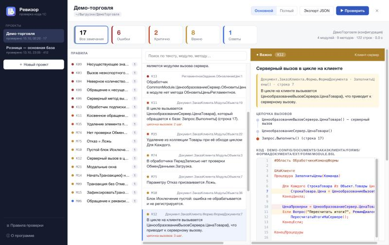
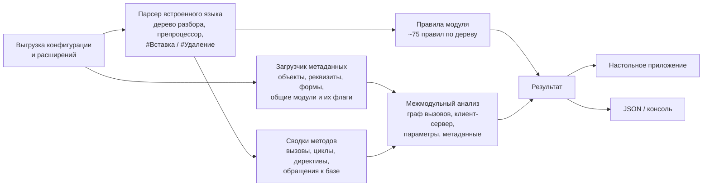
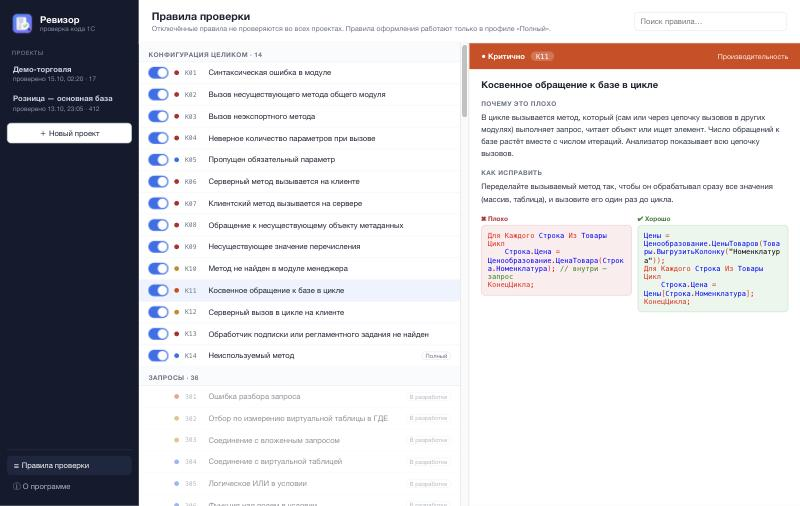

# Ревизор — анализатор кода конфигураций 1С

«Ревизор» — настольное приложение для macOS и Windows и консольная утилита. Он проверяет **всю конфигурацию 1С:Предприятие 8 целиком** по её выгрузке в файлы и находит то, что не видно при просмотре одного модуля:
- вызовы несуществующих методов и неверное число параметров;
- нарушения клиент-серверного взаимодействия;
- обращения к базе в цикле через цепочку вызовов в нескольких модулях;
- нарушения стандартов 1С:ИТС.

> Это **превью** проекта: описание, архитектура, фрагменты кода, демо-выгрузка и результаты проверки. Полный исходный код не публикуется, он доступен по запросу.
>
> 📽 Презентация: https://geronimo1984.github.io/1c-code-revizor/



---

## Задача

Конфигуратор проверяет синтаксис модуля и часть ошибок при компиляции. При этом многие ошибки видны только при взгляде на всю конфигурацию сразу:
- метод общего модуля переименовали, а вызовы в формах остались;
- клиентская форма вызывает серверный модуль;
- цикл по строкам документа вызывает «безобидную» функцию, а та через три модуля выполняет запрос.

Такие ошибки обычно находят уже у пользователя: по медленной работе или по ошибке во время выполнения.

## Что проверяет

| Группа | Правила |
|---|---|
| **Компиляция** | Синтаксические ошибки; вызов несуществующего или неэкспортного метода общего модуля и модуля менеджера; неверное количество параметров; обращение к несуществующему объекту метаданных и значению перечисления; обработчики подписок на события и регламентных заданий |
| **Клиент-сервер** | Серверный метод в клиентском коде и клиентский метод на сервере (с учётом `#Если Сервер/Клиент`); серверный вызов в цикле на клиенте с полной цепочкой |
| **Производительность** | Запрос, `ПолучитьОбъект()`, `НайтиПо…()` и чтение реквизитов в цикле: и прямые, и **косвенные через цепочку вызовов в других модулях**. Модули с повторным использованием значений учитываются |
| **Корректность** | Удаление из коллекции при обходе, недостижимый код, процедура возвращает значение, функция без `Возврат`, `Отказ = Ложь`, пустой `Исключение`, `СтрШаблон` без параметров, повторяющиеся условия |
| **Транзакции** | `НачатьТранзакцию()` не перед `Попытка`, фиксация и отмена транзакции вне своих блоков, отсутствие отмены |
| **Безопасность** | `Выполнить`/`Вычислить`, привилегированный и безопасный режим, IP-адреса, пути и пароли в коде, запуск внешних приложений |
| **Стандарты и оформление** | Правила 1С:ИТС и каталога диагностик BSL Language Server (в профиле «Полный») |

Каждое правило снабжено карточкой: почему это плохо, как исправить, примеры «плохо» и «хорошо», ссылка на стандарт.

## Пример: цепочка вызовов

Фрагмент результата проверки демо-выгрузки ([examples/cli-output.txt](examples/cli-output.txt)):

```
К12   Важно   Серверный вызов в цикле на клиенте
      Документ.ЗаказКлиента.Форма.ФормаДокумента:7
      В цикле на клиенте вызывается ЦенообразованиеВызовСервера.ЦенаТовара(),
      что приводит к серверному вызову.
        → ЦенообразованиеВызовСервера.ЦенаТовара() — серверный вызов
        → ЦенообразованиеСервер.ЦенаТовара()
        → Запрос.Выполнить() (строка 17)

К04   Ошибка  Неверное количество параметров при вызове
      ЦенообразованиеСервер.ЦеныТоваров(): передано параметров 3, а метод принимает 2.
```

## Архитектура



- **Парсер** — собственный, на Go. Разбирает около 76 тыс. реальных модулей типовых и доработанных конфигураций без ложных синтаксических ошибок.
- **Память:** дерево разбора модуля сразу сворачивается в компактную сводку, поэтому конфигурации уровня КА/ERP проверяются в ограниченном объёме памяти. По умолчанию анализ использует половину ядер процессора.
- **Расширения:** проверяются вместе с основной конфигурацией или отдельно. Без основной конфигурации обращения к заимствованным объектам не проверяются.
- **Интерфейс:** результаты хранятся в движке и подгружаются порциями. Код показывается с подсветкой как в конфигураторе и маркерами замечаний.

## Фрагменты кода

| Файл | Что показывает |
|---|---|
| [01_preprocessor_conditions.go](snippets/01_preprocessor_conditions.go) | Учёт `#Если Сервер / Клиент` при проверке контекста вызова |
| [02_call_resolution.go](snippets/02_call_resolution.go) | Разрешение вызова: локальный метод, глобальный модуль, `ОбщийМодуль.Метод`, `Справочники.X.Метод` |
| [03_db_access_chain.go](snippets/03_db_access_chain.go) | Транзитивный поиск обращения к базе через цепочку вызовов |
| [04_client_server.go](snippets/04_client_server.go) | Контекст выполнения метода и проверка клиент-серверных вызовов |
| [05_parameter_count.go](snippets/05_parameter_count.go) | Проверка числа параметров при вызове |
| [06_resource_limits.go](snippets/06_resource_limits.go) | Свёртка однотипных замечаний |

## Демо

[examples/demo-config](examples/demo-config) — вымышленная выгрузка «Демо-торговля» с намеренными ошибками. Результаты проверки лежат в [examples/cli-output.txt](examples/cli-output.txt) и [examples/result.json](examples/result.json).



## Технологии

Go · Wails (WebView2 на Windows, WebKit на macOS) · веб-интерфейс без сборщиков · один исполняемый файл без зависимостей.

## Дальше

- Правила для текстов запросов и проверка запросов по метаданным: таблицы, поля, табличные части.
- Проверка компиляции через пакетный режим конфигуратора.
- Отчёты HTML и SARIF для GitLab/GitHub.
